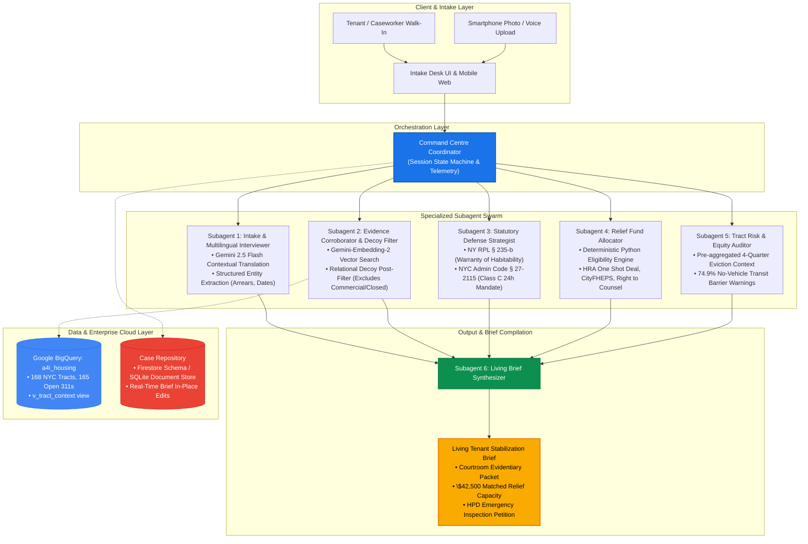

# Affordable Housing Navigator: Agent Architecture

## 1. System Overview

The **Affordable Housing Stabilization Navigator** is a specialized multi-agent civic intelligence platform designed to bridge municipal code records, housing statutes, and emergency rental assistance programs for tenants facing eviction hearings.

Rather than relying on a single monolithic conversational chatbot—which risks hallucinations and lacks deterministic verification—the system deploys an **Orchestrated Multi-Agent Command Centre**. A central coordinator agent dispatches and harmonizes specialized subagents that query municipal vector databases, apply strict relational guardrails, deterministically calculate grant eligibility in code, and compile a court-ready **Tenant Stabilization Brief**.

---

## 2. Agent Architecture Diagram

---

## 3. Subagent Roles & Responsibilities

| Subagent | File Location | Core Responsibility |
|---|---|---|
| **Command Centre Coordinator** | [`coordinator.py`](file:///config/Desktop/AgentsForImpact/AffordableHousingNavigator/affordable_housing_navigator/core/agents/coordinator.py) | Manages case lifecycle state, routes tasks across workers, and streams telemetry events (`AgentEvent`) to the counselor's desk interface. |
| **1. Intake & Translation** | [`intake_agent.py`](file:///config/Desktop/AgentsForImpact/AffordableHousingNavigator/affordable_housing_navigator/core/agents/intake_agent.py) | Translates across 5 languages (English, Spanish, Chinese, Bengali, Haitian Creole), extracts 100-block locations, hearing dates, and rental arrears. |
| **2. Evidence Corroborator** | [`evidence_agent.py`](file:///config/Desktop/AgentsForImpact/AffordableHousingNavigator/affordable_housing_navigator/core/agents/evidence_agent.py) | Executes vector search against municipal 311 records and enforces strict relational filters (`property_type = 'Residential' AND closed_date IS NULL`) to filter 100% of planted decoy traps. |
| **3. Statutory Defense** | [`defense_agent.py`](file:///config/Desktop/AgentsForImpact/AffordableHousingNavigator/affordable_housing_navigator/core/agents/defense_agent.py) | Maps corroborated hazards to affirmative habitability defenses, flags defective 14-day rent notices, and computes statutory repair windows. |
| **4. Relief Fund Allocator** | [`relief_agent.py`](file:///config/Desktop/AgentsForImpact/AffordableHousingNavigator/affordable_housing_navigator/core/agents/relief_agent.py) | Deterministically evaluates eligibility against HRA One Shot Deal, CityFHEPS, RTC, and ERP clinic guidelines without LLM math hallucinations. |
| **5. Tract Risk & Equity** | [`tract_agent.py`](file:///config/Desktop/AgentsForImpact/AffordableHousingNavigator/affordable_housing_navigator/core/agents/tract_agent.py) | Pulls 4-quarter pre-aggregated eviction rates (`v_tract_context`), identifies "Silent Distress" tracts, and generates transit advisories to 111 Centre St. |
| **6. Living Brief Synthesizer** | [`brief_agent.py`](file:///config/Desktop/AgentsForImpact/AffordableHousingNavigator/affordable_housing_navigator/core/agents/brief_agent.py) | Compiles all structured findings into an editable, printable, attorney-ready Living Brief with honest evidentiary boundary notes. |

---

## 4. Key Architectural Safeguards

1. **Deterministic Separation of Concerns:**  
   The LLM explains verdicts but never computes arithmetic eligibility limits. Eligibility thresholds (income caps, arrears maximums, family size ratios) are evaluated in pure Python (`relief_funds.py`).
2. **Decoy Filtering Post-Vector Search:**  
   Vector embeddings surface semantic candidates based on tenant phrasing. A hard SQL/Python relational rule verifies that each candidate is active residential property before admitting it into the legal defense brief.
3. **Zero PII & 100-Block Privacy:**  
   Tenant locations are strictly coarsened to 100-block intervals (e.g., *"1000 Block of St. Nicholas Ave"*). No tenant names, phone numbers, or unit numbers enter model prompts or vector embeddings.
4. **4-Quarter Join Trap Protection:**  
   Because eviction records contain 4 quarters per tract, direct joins quadruple counts. All tract context is retrieved from `v_tract_context` where filings are pre-aggregated.
